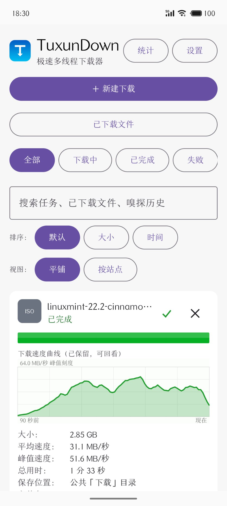
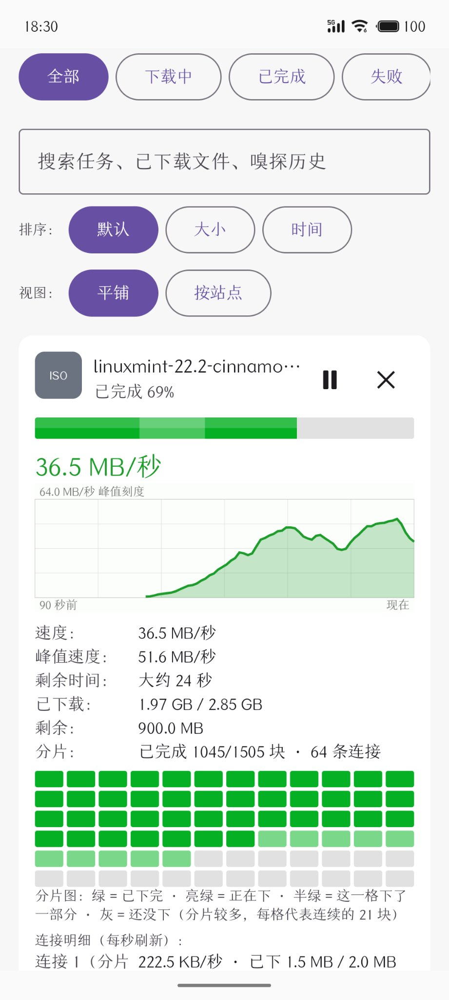
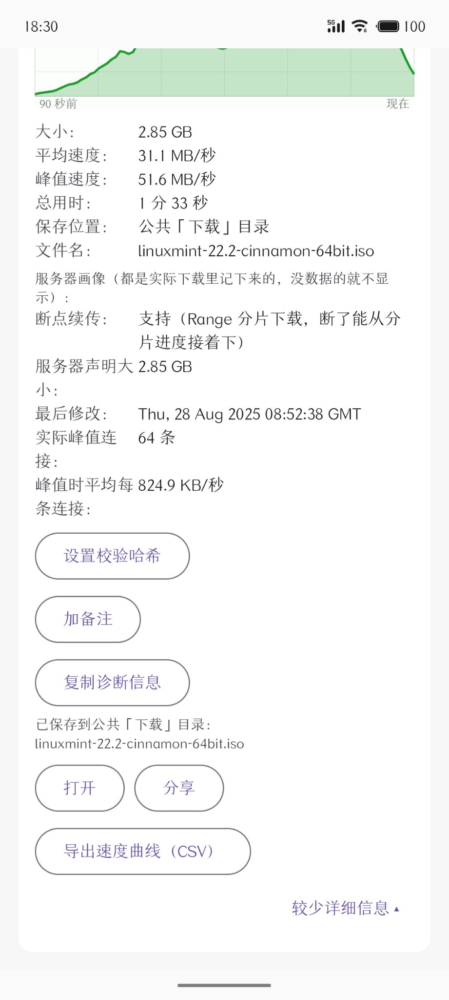

<p align="center">
  
</p>

<h1 align="center">TuxunDown</h1>

<p align="center">
  极速多线程下载器（Android），免费开源。<br>
  把文件切成小块、多条连接同时下载，专为「单条连接被限速」的场景而生：断点续传、资源嗅探、流媒体下载、多源并下与 WiFi＋流量双通道，全都装在一个不到 1.5 MB 的安装包里。
</p>

<p align="center">
  <a href="https://github.com/liyuzhou79-star/TuxunDown/releases/tag/v8.0.0"></a>
  <a href="https://github.com/liyuzhou79-star/TuxunDown/releases"></a>
  
  
  <a href="LICENSE"></a>
</p>

<p align="center">
  <a href="#下载"><b>下载最新版</b></a> ·
  <a href="#截图">截图</a> ·
  <a href="#功能">功能</a> ·
  <a href="#已知限制">已知限制</a> ·
  <a href="#许可">许可</a>
</p>

---

## 下载

当前最新正式版：**v8.0.0**

- 发布页：[v8.0.0](https://github.com/liyuzhou79-star/TuxunDown/releases/tag/v8.0.0)
- 安装包直达：[TuxunDown-v8.0.0.apk](https://github.com/liyuzhou79-star/TuxunDown/releases/download/v8.0.0/TuxunDown-v8.0.0.apk)（约 1.4 MB）
- 全部历史版本：[Releases](https://github.com/liyuzhou79-star/TuxunDown/releases)

系统要求：Android 10 及以上。所有正式版都用同一把固定签名钥匙签署，新版可直接覆盖安装，不用卸载旧版。

## 截图

以下截图来自真实手机上的实际使用界面：

<p align="center">
  
  
  
</p>

<p align="center">
  主页与已完成任务、速度曲线 · 下载进行中 · 任务详情与服务器画像
</p>

## 功能

- **多线程分片下载**：把文件切成小块、多条连接同时下载；单个任务最多 128 条连接，新任务先开一批连接起步、再自动试探最佳线程数（速度不再涨就停；试探阶段每秒评估一次，下过文件的站点会记住最佳连接数、下次先开一批、两三秒内分档加满到记住的数目（渐进放行，是出厂默认，不一开局就全开满；那种第 0 秒全开满的「瞬间满开」还留在程序里，但默认关着）），先下完的连接会回头帮忙下最慢的块；卡住不动的连接会被换掉，换的快慢按任务当前速度定（下得越快换得越果断，慢站更耐心，只剩一条连接时不换）；相邻的小分片会合并成一次请求下完，请求次数更少；设置里可打开「尾巴双下（实验）」（默认关闭）：收尾时最后的小块由两条连接竞速、先下完的算数，同一段字节只记一次账、速度和进度不虚报，重复下载的流量有硬上限（不超过文件 1%、最多 4 MB），流媒体和 FTP 不参与；同一台服务器下过的文件会记住它的最佳线程数，下次渐进放行到那个数目起步。
- **断点续传**：暂停、断网、重启 App 都能从断点继续；服务器上的文件变了会识别出来重新下，不把两个版本拼在一起。下载中途切网、开关飞行模式、切换 VPN 造成断网时，任务会先停泊等网络恢复再自动继续，不直接失败；连上要登录的公共 WiFi 时，任务会停下等你打开浏览器完成登录、然后自动接着下，登录页不会被当成文件存下来。
- **资源嗅探**：粘贴网页链接，自动列出页面里可下载的资源（安装包、压缩包、视频、音频、图片、文档），并顺带测出每个文件的大小（测大小有总时限，不会久等）；页面资源特别多时只列出先找到的一部分并明说；下载入口藏在中间页里时，会顺着唯一的下载路径自动追到真实文件；追不动时可用内置浏览器手动点到下载那一步，或长按页面里的链接直接下载；内置浏览器里登录过的网站，可以一键清除登录状态和浏览数据。嗅探结果会折叠统计/广告类噪音、标出疑似重复的资源，关掉后还能从主页重新打开接着选；新建下载框里的嗅探历史每条旁边都有「重新嗅探」按钮，点一下就用原来的网页地址重新抓一遍，抓失败时原来的历史和上次结果都原样保留。
- **流媒体下载**：m3u8（HLS）链接自动分段下载并合并成一个 .ts 文件，记住的站起步也改渐进：先开一批（最多 8 条）、不够再逐步加上去，能到达的并发上限不变；分段并发会按站点最佳连接数和实际速度自适应增减，支持断点续传和 AES-128 解密；分片在内存里的占用是所有流媒体任务一起算的全局上限，并按设备内存分档，内存小的手机也不会因为分片太大爆内存；遇到带多档清晰度的主播放列表时，新建或嗅探下载会先让你选一档再下（单档或读取失败时自动处理）。
- **多源并下与双通道**：同一个文件填多个镜像地址，下载前逐个校验（大小＋内容抽样，对不上的拒绝并说明；没能确认是不是同一个文件的——比如镜像需要登录——不会算作对不上，只会说明没能确认、先不用它），一起加速；在任务的镜像管理里，每个镜像都会按已有的校验记录标明已确认、待确认（可能需要登录）、已拒绝或还没校验，待确认的镜像可以点「仍然使用」手动放行让它参与下载（只对这个任务有效、随时可取消，已经证明是别的文件的不能放行）；还能同时用 WiFi 和流量两条网络下载（系统不给流量网络时会明说用不了）。镜像地址的填写口径已和主链接统一，ftp 镜像也能填了。
- **FTP 下载**：ftp:// 链接直接下，支持断点续传；服务器支持断点续传时支持多连接分片（最多 8 条连接同时下），不支持时自动单连接并在卡片写明。
- **任务管理**：队列与插队（同优先级里不同站点轮流开始，不会被一长串同站任务饿着，插队仍最优先；排队中的任务卡片会写明排在第几位，低优先级任务连续排队满 30 分钟会自动按中优先级排队，不会被一直压着）、同时下载个数（1–5）、全局连接上限（所有任务合计 8–128 条、默认 32，多任务同时下时按优先级加权、再按每个任务实时真正需要的连接数分摊，用不完的份额会让给其他任务，被压住的任务卡片会写明；多个任务同时开始或中途加入时连接数平滑爬升，不会短暂冲过上限，上限调低仍立即生效）、预约开始与每天定时（每天定时会记下你选的时间，换时区或改了系统时间后，排队中的任务会自动按新时区重新对准到你选的时间；这一版之前建的每日任务没存下时间，换时区仍会漂移）、失败自动重试、断网自动恢复、批量多选、滑动手势、长按任务卡弹出快捷菜单（暂停、继续、插队、改优先级、加备注、复制链接、删除都在菜单里，多选入口也在菜单末尾）、扫码添加链接、按标签页/搜索/排序整理任务；建任务时会先查重：同一链接只要还有未完成的任务在列表里（排队、下载中、暂停、失败都算，主地址或任一镜像对上都算同一个）就不再重复建，批量粘贴或导入时会明说跳过了几个重复，已经下完的历史不拦、想再下一份照样可以；有任务失败、或被断网、等登录、等充电、等 WiFi 停住时，标签页会多出「异常（N）」，点一下只看这些出问题的任务；下完自动校验 SHA-256 / MD5（填了期望值时，可关、可中途取消；期望值从发布页整行复制、带文件名或前缀也能认）；设置里打开「自动读取校验文件」（默认关）后，新建下载还会顺手找网站放在文件旁边的 .sha256 / .md5 校验文件，下完按网站给的值核对并在卡片上写明来源。新任务点下就开下，不会被队列正在进行的等待（等预约时间、等插电等）拖住；有任务在下时，排第一位的下一个任务会提前预热连接（仅 WiFi 或双通道，流量保护开着、用了代理、或没插电且任务在等充电时都不做），轮到它时开局更快；失败原因在出错那一刻按类型记下，失败卡片的处理建议和自动重试都按它判断，不再靠猜失败说明里的字眼；主页汇总卡还会显示一行网络状态：当前是 WiFi 还是流量、双通道是否真的生效中、排队任务正被哪个开关挡着（仅 WiFi／充电／流量保护，只报最先挡住的那个）；主页汇总卡和通知栏都会按当前总速度和剩余总量估算「全部下完大约还要多久」（速度为零或有任务大小未知时不显示）。任务可加备注（搜索能搜到，备份也带着）；排队靠前的链接会提前轻量预检，确认已失效的提前在卡片上标出（轮到时仍会正式再试）；被限流过的服务器会记住它的连接上限，下次自动收着开。迅雷 thunder:// 链接粘进来会自动解码成真实地址。展开任务详情能看分片进度图（每块下到哪了一目了然）和每条连接各自的实时速度，还能看「连接预算」：这个任务当前分到几条连接、是被全局连接上限、站点限流还是任务自身当前的目标压住的，数字实时刷新；还能看「服务器画像」：支不支持断点续传、服务器报的文件大小、实际峰值连接数、每个下载源各下了多少、开过尾巴双下的话还有效绩行（触发次数、重复下载字节、赢家下完时输家还剩多少）——都只展示实际下载里记下的数据，没探到的不显示；详情里显示哪些可选行（平均速度、重试次数、分片进度、创建时间、来源站点）可在设置里自选开关。详情页的操作按钮已收紧成并排的小按钮，不再一个按钮占一整行；已完成的任务还能在详情里点红色的「删除文件」直接删掉下载好的文件本身（先弹窗确认、删了不能恢复，记录会留着并标上「文件已不在」，删记录仍是独立的另一个操作）。多选失败任务可「换个方式重试」：批量换浏览器标识（UA）或改单线程再排队，对付按 UA 区别对待或多连接不稳的服务器；失败任务有 2 个以上时，「异常」标签顶部也会出现「失败任务批量处理」入口，一键打开同样的换招重试（停泊中的任务在等条件恢复，不算在内）。新建下载可勾选「展开短链接」，先跟随跳转拿到最终地址再建任务，展开失败会明说并按原链接建；剪贴板里复制的链接，本次打开期间提示过或关掉后不会再重复提示，上次最后提示过的那一条下次打开也不会再弹。
- **全局搜索与按站点分组**：主页搜索框一次搜任务（文件名、链接、备注、站点，含已归档记录）、已下载文件、嗅探历史和帮助话题，结果分四组呈现，帮助结果点一下直达帮助中心对应话题；任务列表可切换到「按站点」视图，按下载站点分组、组头带任务数与总进度，组可折叠且折叠状态会记住（标签先筛、排序只在组内生效）。
- **快捷入口**：下拉通知栏的快捷设置磁贴、主页汇总卡都能一键全部暂停 / 全部继续；长按桌面图标有「新建下载 / 打开嗅探」快捷方式；桌面小部件显示总进度，跟随系统深浅色，上面也能一键全部暂停 / 全部继续；一队任务可以分享成链接清单文本发出去，对方整段粘回即可一次重建整队任务（清单只带主链接，不带 Cookie 等敏感信息；如果链接本身带着参数或账号信息，清单末尾会多一行提醒，确认没问题再发）。
- **已下载文件页**：下好的文件集中管理，按大小/时间排序，显示占用总量，可打开、分享、删除（删记录和删文件分开确认）；能按大小＋哈希找重复文件（只找不自动删，勾选了才删）；孤儿 .part 半成品也能扫出来清理；新增一键对账：记录还在文件没了、文件还在记录没了的会分开列出，由你逐条决定删记录、认领还是保留，绝不自动删；记录对应的文件已经不在时，任务卡、搜索结果和文件页都会提前标上「文件已不在」，打开和分享会置灰，这类记录占的大小也会单独列出、不混进正常文件的总量，文件只是改了名的话，可以把记录里的名字更新成现在的名字。
- **下载代理**：HTTP / SOCKS5 代理（可带账密），下载、嗅探和测速都走它，任务卡上有标记；代理连不上会停下报错，绝不悄悄直连。
- **每任务请求头**：可查看/编辑每个任务带的 Cookie / Referer / User-Agent，续传时生效；导出备份时 Cookie 会被自动剔除，名字里带密钥、令牌、密码字样的自定义请求头（比如 X-Api-Key）也同样剔除。
- **下完之后**：文件下完后的改名、校验、自动解压走专门的收尾流程，不占着下载位置，排在后面的任务立刻就能开下，完成通知在全部收尾做完后才发。校验改用更大的读取缓冲、更快，过程中卡片会实时显示「正在校验…N%」；下完的任务还能把速度曲线导出成 CSV 表格存到下载目录（累计字节按每秒速度推算，文件里会写明；文件开头带生成时间，下载报告、崩溃记录里的时间也都统一写成本地时间并带时区标注）。可自动安装 / 打开文件（默认关）、自动解压 zip 到同名文件夹（默认关，原 zip 保留，带文件数/总大小上限和路径穿越防护；填了校验值时校验对上才解压）；手机重启后可自动恢复未完成任务（默认关）；新文件可按类型自动分进子文件夹（默认关）。
- **保护与提示**：仅 WiFi 下载、充电时才下载（没插电时新任务先排队、插上电源自动开始，已在下的不打断）、流量保护（流量下大文件先暂停问你）、全局限速（多任务按优先级切分总预算，每个任务都有保底份额，慢任务暂时用不完的份额不会转借给别的任务，保证谁都不会被饿着）＋限速计划（每天指定时段自动换另一档，典型用法是夜间不限速，过点自动切换）、自定义 User-Agent、AMOLED 纯黑、后台保活引导、下载传输期间保持 CPU 运行做到息屏不降速（设置里可关，代价是更费电，排队等待时不占用）、内置测速页（单/多线程同口径稳态测速，结论分三档说明，最近 10 次结果留成历史方便对比；有任务正在下载时测速会互相抢带宽、结果偏低，测速页会提醒）；完成通知带「打开 / 分享」按钮，展开能看到文件大小与平均速度，多个完成会合并成一条（每个大小都已知时标出总大小），可设夜间静默时段（只静音、不拦通知）；下载最终失败也会发通知，带失败原因短句，普通失败可直接在通知上点「重试」，需要先处理的失败会说清先做什么，短时间里多个失败合并成一条，失败通知不震动、不响铃；设置页「提示」一栏有一行「通知现状」，通知权限开没开、静默时段现在是不是正在生效一眼就能看到；设置里有一键诊断页（存储、网络、代理、版本自检，结果只在本机、可复制报障；诊断页新增「安全现状」一栏：申请了哪些权限、有哪些组件对外开放、代理密码是加密保存还是未设置，一眼看清（只说保存方式，不显示密码本身）；诊断页还新增「存储健康」一栏：任务记录、站点学习、下载统计、嗅探历史等每个存储有多少条、是否健康，一眼看清，设置读取失败或子存储丢了行数也会在这里如实显示；诊断页还有「任务状态分布」一栏：排队、下载中、暂停、完成、失败各有多少个，有多少在等网络、等充电、等登录，本次运行里拦下过的不合法状态变化有多少次，一眼看清；诊断页还有「功耗」一栏：保持唤醒的累计时长、速度采样的累计次数和当前正在轮询的来源数，一眼看清，界面在没有任务活动时也不再每秒空刷、更省电；诊断页还有「资源」一栏：当前进程的线程数（读取瞬间的近似值）、当前内存档位和正在采样中的任务数，都是当场读到的真实数字；诊断页顶部还有一键体检，把版本、内存、空间、网络、解析、任务状态和设备温控汇成一页速览，温控分正常／偏热／发热降速中三档、读不到时不显示这一项，点了才跑、结果可复制；正在下载时手机发热降速，通知里会提醒速度变慢可能不是网络的问题，只提示、不会自动暂停或降速；还能看这台手机的内存档位和上次启动耗时，下载缓冲会按内存档位自动分档——内存小自动收紧、内存大略放宽；还能拿自己的链接实测 4 / 16 / 32 / 64 / 128 条连接哪个最快，实测结果可一键应用到对应站点，设置里也能清除按主机学习数据）；每个任务的详情里也能复制一份单任务诊断（链接去掉参数、请求头只列名字，敏感值不外带）。任务的登录 Cookie 只会发给链接本身的站点：用镜像加速、或服务器跳转到别的站点时，不会把原站的登录状态带过去。
- **备份与迁移**：设置＋任务记录导出成一个 JSON 文件，换手机或重装后导入全恢复；统计页还会按每个任务达到过的最高速度列出「最快纪录」前三名（文件名、峰值速度、完成时间，没有测出过速度的记录不列）。另有完整迁移包，把下载统计和按主机学习数据（每个站的最佳线程数、限流上限）也一起带走，旧版备份照常能导。下载目录和敏感信息（Cookie、授权头、名字里带密钥/令牌/密码字样的自定义请求头、代理密码、本机专属的目标位置）不在备份内；备份导入时主链接和镜像只收 http、https、ftp 开头的，本地文件类链接会被跳过。任务记录文件万一损坏，会先用备份文件自动恢复，个别记录坏了会从备份补回；实在救不回时会把坏文件留在一边保存好，并在主页明说，不会悄悄清空。每个任务的状态变化都有一道统一守卫：正在下载或已经下完的任务不会被误操作重新排队，你手动暂停的任务也不会被自动恢复抢跑；文件下完只差最后改名收尾时程序被关掉的，下次打开会自动补完收尾，不用重新下载。
- **诚实提示**：服务器不支持分片（Range）时会退回单线程并在界面说明原因；加线程不再提速时也会提示可能被服务器按 IP 限速，不假装加速。

速度上限取决于你的网络带宽和服务器的限速方式：多线程能抢回的是「单条连接被限速」浪费掉的那部分带宽。实测同一个 271 MB 大文件，浏览器单线程约 300 KiB/秒，TuxunDown 约 6 MB/秒（约 20 倍）。

任务卡片、通知栏、桌面小部件和快捷设置磁贴用同一套状态说法：失败就叫失败、全在排队时就说排队中，哪个地方都不会换个说法让人猜。文件下完之后的校验、改名、解压收尾期间，这四处都会显示「正在收尾…」，真正处理完才变「已完成」，收尾期间打开、分享会先禁用并写明原因；连接明细里每条连接的速度与总速度也是同一套平滑口径，加总对得上。

## 已知限制

有些情况是目前明确接受的限制（比如不支持磁力链接、FTP 功能较简单），都写在 [已知限制](docs/known-issues.md) 里，每条都说明会发生什么、为什么、以及能怎么办。

## 权限与体积

一共申请 10 项系统权限，每项都有明确用途：联网下载（INTERNET）、判断当前是 WiFi 还是流量（ACCESS_NETWORK_STATE）、在后台继续下载的前台服务（FOREGROUND_SERVICE、FOREGROUND_SERVICE_DATA_SYNC）、发送下载进度与完成通知（POST_NOTIFICATIONS）、完成时震动（VIBRATE）、打开系统的电池白名单页面（REQUEST_IGNORE_BATTERY_OPTIMIZATIONS，App 自己不改任何系统设置）、扫码添加链接时用相机（CAMERA，只在扫码页面打开时用）、开机后恢复未完成任务（RECEIVE_BOOT_COMPLETED，只服务于默认关闭的那个开关）、下载传输期间保持处理器运行做到息屏不降速（WAKE_LOCK，只在真正传输时持有，设置里可关）。

安装包保持小体积：现行正式版为 8.0.0；发布流程带有体积守门，签名包超过 1.5 MB（1,572,864 字节）就直接发布失败。

## 不做的事

不做磁力 / BT 下载、不做网盘限速处理、不做网盘分享页解析。所有任务记录只存在本地，不收集、不上传任何数据。

## 构建

GitHub Actions 自动构建（Build Debug / Build Release 工作流）。本地构建需要 JDK 17 与 Android SDK：

```
./gradlew :app:assembleDebug
```

## 许可

GPLv3，见 [LICENSE](LICENSE)。
